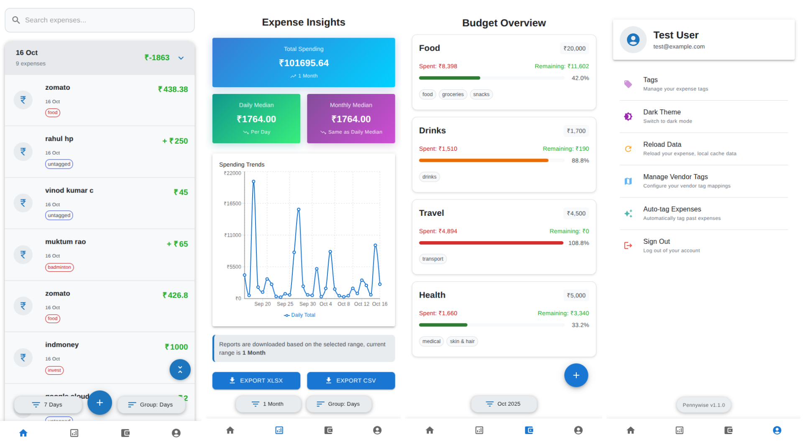
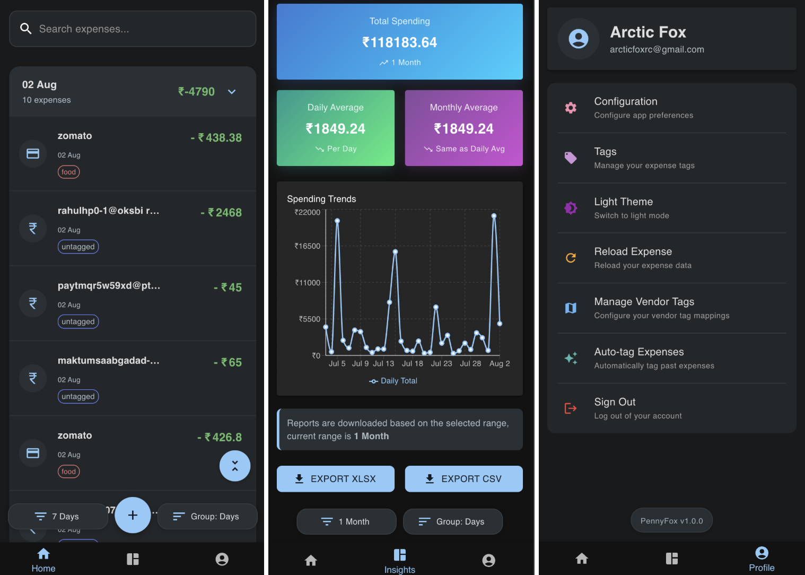
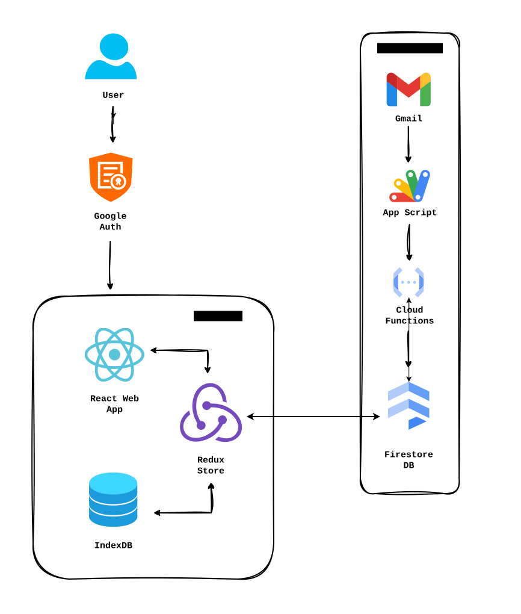

<div align="center">
  <br/>
  <table align="center">
    <tr>
      <td align="center" valign="middle" style="padding: 0 6px;"></td>
      <td align="center" valign="middle" style="padding: 0 6px;"></td>
    </tr>
  </table>
  <h1>Pennywise × Gemini</h1>
  <h3>Track, Analyze, and Master Your Personal Finances</h3>
</div>

<p align="center">
  <a href="#license">License</a> •
  <a href="#overview">Overview</a> •
  <a href="#features">Features</a> •
  <a href="#demo">Demo</a> •
  <a href="#getting-started">Getting Started</a> •
  <a href="#Security-and-Cost">Security and Cost</a> •
  <a href="#technology-stack">Tech Stack</a> •
  <a href="#architecture">Architecture</a> •
  <a href="#project-structure">Project Structure</a> •
  <a href="#Future-Roadmap">Future Roadmap</a> •
  <a href="#support-the-project">Support Project</a>
</p>

---
> **How email import works:** After you connect Gmail (read-only), Gmail push notifications land on a Pub/Sub topic and a Cloud Function reads new INBOX mail within seconds. Known bank templates are parsed with regex first; **Gemini** is the fallback for unparseable messages.  
> **Bank list (filter):** In **Settings → Banks** you add one or more entries with a display name and **match strings**. Only matching mail is parsed.  
> **Practical limit:** Your bank or card issuer should send **consistent** alert layouts for the transactions you care about. If formats vary, adjust match strings or rely on Gemini. An hourly sweep renews `users.watch` and catches dropped push events.

## License

This project is licensed under the [MIT License](LICENSE).


## Overview

Pennywise is a comprehensive, open-source web application designed to empower individuals in managing their personal
finances. It provides an intuitive platform to track, categorize, and visualize expenses, helping users gain clear
insights into their spending patterns and achieve financial mastery. Built with modern web technologies, Pennywise offers
a user-friendly experience with robust features, including offline caching, secure authentication, automatic Gmail
import, and separate layouts tuned for desktop and phone.

## Features

* 📊 **Expense Tracking**: Easily add, edit, delete, and search your daily expenses with detailed inputs.
* 📧 **Gmail + Gemini**: Connect Gmail in Settings. Push notifications plus an hourly sweep import messages that match **banks you configure**; regex parses known templates and **Gemini** fills in the rest. A new connection backfills the last 30 days.
* 🏦 **Configurable banks**: Under **Settings → Banks**, add or remove banks and **match strings** so only relevant sender/templates are parsed (and, when regex fails, sent to the model).
* 🏷️ **Tagging System**: Categorize expenses with custom tags for flexible and granular organization.
* 🤖 **Auto Tagging**: Imported expenses get a tag automatically when their vendor matches one of your **vendor–tag maps**. **Settings → Auto-tag Expenses** applies the same maps to older untagged expenses from a date you pick.
* 🧹 **Duplicate Detection**: After each import, Cloud Functions look for duplicate alerts (for example the same payment reported by a card and a UPI app). Clear duplicates are hidden automatically; doubtful pairs wait in **Settings → Duplicate Review**, where you choose **Confirm duplicate** or **Not a duplicate**.
* 🔗 **Merge & Bulk Actions**: Long-press to select several expenses on Home, then merge them into one expense or delete them together.
* 📅 **Date Filtering**: Filter expenses by various time periods (e.g., 1 day, 7 days, 2 weeks, & more) and group them by day, vendor, tag, or cost.
* 📊 **Visualization**: Understand spending patterns at a glance through interactive charts, a top-vendors table, and spending/daily/monthly figures on **Insights**.
* 📤 **Export**: Download the expenses behind your current Insights view as **XLSX** or **CSV**.
* 💰 **Budgets**: Create budgets that cover one or more tags and track monthly progress; the desktop dashboard flags budgets that are over 80%.
* 🖥️📱 **Desktop & Mobile Layouts**: From 800px up, a side navigation and a "This month" dashboard panel; on phones, a bottom navigation and a compact stats header.
* 🔄 **Offline Caching**: Data is cached locally using IndexedDB to reduce Firestore queries, but the app requires
  internet connectivity to function fully.
* 🔒 **Google Authentication**: Secure and convenient login with Google through Firebase Authentication, limited to email addresses you allow.

## Demo

Public demo: [https://pennywise-demo.web.app](https://pennywise-demo.web.app). It runs on synthetic sample data and redeploys on every push to `main`.

### Demo mode
Signed-out visitors, and signed-in users whose email is not on the allowlist, use this same app on mock data and see a "You're viewing demo data." banner. Only verified Google accounts with a document in the Firestore `allowedUsers` collection (document ID = lowercase email) can read live data. The Firestore security rules enforce this allowlist; no extra environment variable is needed.

<!-- TODO: update screenshot -->

<!-- TODO: update screenshot -->


## Getting Started

For detailed setup instructions, please refer to the guide below (30-60 min setup time). If you already run Pennywise, follow the **Existing install / upgrade** checklist in [SETUP.md](SETUP.md) before deploying the `users/{uid}` rules — old root collections stay hidden until you migrate.
<p align="center">
  <a href="SETUP.md" target="_blank" rel="noopener noreferrer" style="display: inline-block; padding: 10px 20px; background-color: #008CBA; color: white; text-decoration: none; border-radius: 5px;">
    View Setup Instructions
  </a>
</p>

## Security and Cost

Pennywise is designed with your data privacy and security as a top priority. Unlike many other financial apps, Pennywise
gives you complete control over your data and infrastructure. Here’s what makes our approach to security different:

* **🔒 You Own Your Data**: Your financial data is yours alone. It is stored in your own Google Firebase Firestore
  instance, not on our servers. You have full control over who can access it.

* **☁️ Self-Hosted on Your Google Cloud**: You deploy Pennywise on your personal Google Cloud project. This means you
  manage the entire infrastructure, ensuring that you are the only one with access to the backend services and database.

* **💸 No Hidden Costs**: Pennywise is open-source and free to use. You only pay for what you use on the Google Cloud
  Platform, which offers a generous free tier for Firebase and Cloud Functions. Gmail import also uses Pub/Sub, Cloud
  Scheduler, Secret Manager, and the Gemini API; for one person's mail these usually cost little or nothing, and you can
  enable an optional billing budget alert in Terraform.

* **🚫 No Ads, No Tracking**: Pennywise is a completely ad-free platform. We do not track your behavior or sell your data
  to third parties. Our goal is to provide a tool that helps you manage your finances, not to monetize your personal
  information.

* **📖 Open Source Transparency**: The entire codebase is open-source. You can inspect the code yourself to verify that
  there are no hidden trackers or malicious logic. This transparency ensures that we are accountable to our users.

* **🔐 Secure Authentication**: We use Google Sign-In through Firebase Authentication, which provides a secure and reliable way to log
  in to your account without us ever seeing or storing your password.

* **🔑 Minimal Permissions**: The web app uses Google Sign-In. Gmail ingest requests **gmail.readonly** only. Mail is never labelled or marked; processing state lives in Firestore. Tokens are stored in Secret Manager, not in client-readable docs.

* **⚙️ You Control Updates**: Since you host the application, you are in full control of when and how you update it. You
  will never be forced into an update that changes the functionality or privacy in a way you don't agree with.

* **🔒 Secured Infrastructure**: All backend services on Google Cloud are protected by Google's authentication mechanisms,
  including the infrastructure exposed to the public internet. Firestore rules only serve data to allowlisted, signed-in
  owners, and the Cloud Functions are either authenticated callables or triggered internally by Pub/Sub and Cloud Scheduler.

By putting you in control of your data and the application's infrastructure, Pennywise offers a transparent and secure
way to manage your personal finances.

For a detailed explanation of the security architecture, please see the [Security Policy](SECURITY.md).

## Technology Stack

Pennywise leverages a modern and robust set of technologies to deliver a user-friendly and maintainable application.

### Frontend

* **UI Framework**: [React 18](https://react.dev/)
* **Type Safety**: [TypeScript](https://www.typescriptlang.org/)
* **Build Tool**: [Vite](https://vite.dev/)
* **Component Libraries**: [Material-UI v6](https://mui.com/) and [Ant Design](https://ant.design/)
* **Animations**: [Framer Motion](https://www.framer.com/motion/)
* **Charts**: [Recharts](https://recharts.org/en-US/)
* **Styling**: SCSS with shared design tokens (`src/styles/theme.scss`)

### State Management

* **Centralized State**: [Redux Toolkit](https://redux-toolkit.js.org/)

### Data Storage

* **Cloud Database**: [Firebase Firestore](https://firebase.google.com/docs/firestore) (per-user data under `users/{uid}`)
* **Offline Storage**: [IndexedDB](https://developer.mozilla.org/en-US/docs/Web/API/IndexedDB_API) (
  via [idb](https://www.npmjs.com/package/idb) library)

### Authentication

* **Sign-in**: [Firebase Authentication](https://firebase.google.com/docs/auth) with the Google provider
* **Gmail consent**: [Google Identity Services](https://developers.google.com/identity/oauth2/web/guides/use-code-model) authorization-code popup (`gmail.readonly`)

### Backend & Infrastructure

* **Serverless**: [Cloud Functions for Firebase](https://firebase.google.com/docs/functions) (2nd gen, Node.js 22)
* **Messaging & Scheduling**: [Pub/Sub](https://cloud.google.com/pubsub) (Gmail push) and [Cloud Scheduler](https://cloud.google.com/scheduler) (hourly sweep)
* **Secrets**: [Secret Manager](https://cloud.google.com/secret-manager)
* **AI Parsing**: [Gemini API](https://ai.google.dev/)
* **Infrastructure as Code**: [Terraform](https://www.terraform.io/)
* **Hosting**: [Firebase Hosting](https://firebase.google.com/docs/hosting)

### Utilities

* **Date Manipulation**: [dayjs](https://day.js.org/)
* **Exports**: [ExcelJS](https://github.com/exceljs/exceljs) and [json-2-csv](https://www.npmjs.com/package/json-2-csv)
* **Testing**: [Vitest](https://vitest.dev/), Node's built-in test runner, and the Firestore emulator for security rules

## Project Structure

```
pennywise/
├── build/                  # Production build output (Vite)
├── functions/              # Firebase Cloud Functions
│   ├── gmail/              # Gmail connect/disconnect, push handler, hourly sweep, ingest
│   ├── dedupe/             # Duplicate expense detection
│   └── src/parse/          # TypeScript parsers (bank regex + Gemini)
├── infra/terraform/        # GCP resources firebase deploy cannot create
├── shared/                 # Names shared by Terraform, functions, and the web app
├── public/                 # Static assets served directly
│   └── docs/               # Diagrams and screenshots used by the docs
├── scripts/                # Utility scripts
│   ├── backup/             # Full Firestore backup (npm run backup)
│   ├── migrate/            # Move old root collections into users/{uid}
│   └── export/             # Legacy top-level collection export
├── tests/                  # Firestore security rules tests
└── src/                    # React application source code
    ├── api/                # Live (Firestore) and demo data APIs, Gmail connect
    ├── components/         # Reusable UI components (app shell, navigation, demo banner)
    ├── demoData/           # Mock data shown in demo mode
    ├── firebase/           # Firebase configuration & utilities
    ├── hooks/              # Custom React hooks
    ├── pages/              # Application pages & views
    │   ├── budget/         # Budget management pages
    │   ├── home/           # Main dashboard and expense views
    │   ├── insights/       # Analytics, exports, and insights pages
    │   ├── login/          # Authentication flow
    │   └── setting/        # Application settings
    ├── store/              # Redux store configuration
    ├── styles/             # Global styles, themes, and design tokens
    └── utility/            # Helper functions & constants
```

## Architecture

Pennywise is built using a modern front-end architecture with the following key components:

### Overview

1. **User Authentication**:
  - Users sign in with Google through Firebase Authentication
  - Live data is limited to verified emails listed in `allowedUsers`; everyone else gets demo mode
2. **Data Fetching**:
  - On app initialization, data is fetched from Firebase Firestore (`users/{uid}/...`)
  - After the first load, only documents whose `modifiedDate` changed since the last fetch are requested
  - Data is stored locally in IndexedDB (one database per user) for offline access
  - Redux store is populated with expense, tag, vendor-tag, and budget data
3. **User Interactions**:
  - Users can view, search, filter, and group expenses
  - New expenses can be added manually or imported from Gmail
  - Expenses can be tagged, merged, and deleted, and duplicate pairs can be reviewed
4. **Data Persistence**:
  - Changes are saved to both IndexedDB and Firebase
  - Changes made elsewhere (for example new Gmail imports) appear on the next data load; **Settings → Reload Data** forces a refresh

### Gmail automation (push + Gemini)

1. **Bank routing config** is stored per user at `users/{uid}/config/emailParseBanks`. **Settings → Banks** edits this list.
2. **Connect Gmail** in Settings uses Google Identity Services (`gmail.readonly`) and a callable function that stores the refresh token in Secret Manager. A Gmail account can be connected to only one Pennywise user.
3. Gmail `users.watch` publishes to the Terraform topic `gmail-push`. The `onGmailPush` function reads `history.list`, keeps only mail that matches a bank, parses it with regex first and Gemini second, and writes `users/{uid}/expense/{gmailMessageId}`.
4. Each imported expense gets its vendor normalized and, when a vendor–tag map matches exactly, a tag. A processed-message marker keeps imports idempotent.
5. An hourly scheduled function renews the watch (it expires after 7 days) and runs a catch-up plus a resumable 30-day backfill.
6. Terraform owns the topic, service account, and secret shells. `firebase deploy` owns functions, Hosting, and Firestore rules/indexes. See [infra/terraform/README.md](infra/terraform/README.md).

### Duplicate detection

After an import, Cloud Functions scan the last 7 days of expenses for duplicates:

1. **Alias groups**: the same service billed under different vendor names within a few minutes (for example Netflix or YouTube) is merged automatically.
2. **Payment rails**: one investment reported by the broker, the exchange, and the clearing house within 24 hours is merged automatically.
3. **Needs review**: same vendor and type, or the same amount from different vendors within 5 minutes, is never merged on its own. The pair appears in **Settings → Duplicate Review**.

Merged duplicates stay in Firestore but are hidden from lists. The rules can be tuned per user at `users/{uid}/config/dedupeRules`.

### Architecture Diagram

<!-- TODO: update screenshot -->


The Graphviz source for the data flow lives in [public/docs/dataflow.dot](public/docs/dataflow.dot).

## Application Sections

The React application is divided into several key sections, each serving a specific purpose. On screens 800px and wider, a side navigation replaces the phone's bottom navigation.

*   **Home**: This is the main dashboard where you can see a list of your recent transactions. You can add new expenses manually, edit existing ones, attach a tag to the expense, search, and apply filters to view expenses from different time periods or by different grouping. Long-press to select expenses, then merge or delete them. On desktop, a "This month" panel shows spent and received totals, top vendors, tag split, and budget alerts; on phones, a stats header sits above the list.


*   **Insights**: This page offers a visual breakdown of your spending. It shows spending, daily, and monthly figures (average or median), charts grouped by days, vendor, tags, or cost, and a top-vendors table. You can download the reports in xlsx & csv format.


*   **Budget**: This section is for managing your financial goals. You can set monthly budgets for different expense categories and track your progress to see how your spending aligns with your budget.


*   **Settings**: Connect or disconnect Gmail, and manage **Tags**, **Manage Vendor Tags**, **Auto-tag Expenses**, **Duplicate Review**, **Reload Data** (reload from a date, reload everything, or clear the local cache), the dark/light theme, and sign-out. Use **Banks** (`/setting-banks`) to maintain the list of banks (match strings) that gate which emails are parsed—add or remove entries as you add accounts or change issuers.

## Future Roadmap

- [ ] Per-bank prompt hints or templates (optional tuning on top of Gemini)
- [x] Gmail push (Pub/Sub) instead of Apps Script hourly jobs
- [x] Automatic duplicate detection with a review screen
- [x] Separate desktop and mobile layouts
- [ ] Enhancing Insights with more detailed analytics & better graph support grouped by category
- [ ] Multi-selected expense tagging feature
- [ ] Expense analysis using historical data (Firebase AI Logic)
- [ ] Expense sharing/tracking between users (Multi-user persona)

## Contributing & Local Development

We welcome contributions to Pennywise! If you're interested in helping out, please refer to our [Development Guide](DEVELOP.md) for instructions on setting up the project locally, contributing code, and submitting pull requests.


## Support the Project

<a href="https://www.buymeacoffee.com/arcticfoxrc"></a>

---
<div align="center">
  <p>Created with ❤️ by <a href="https://github.com/rushikc"> rushikc </a> & <a href="https://github.com/features/copilot">Copilot</a></p>
  <p>rushikc.dev@gmail.com</p>
</div>
