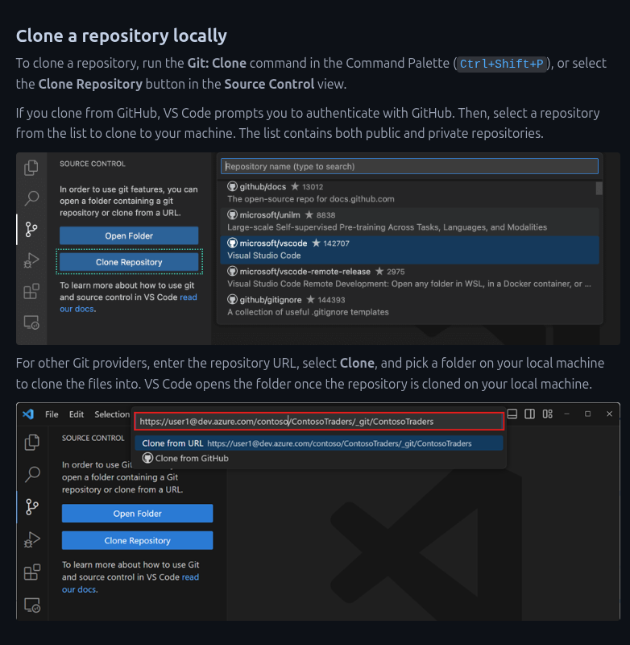
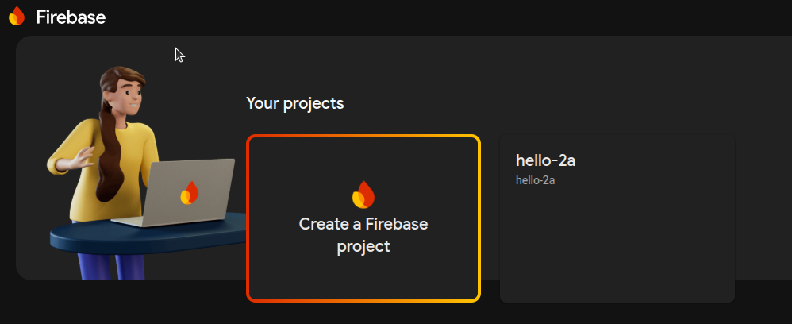
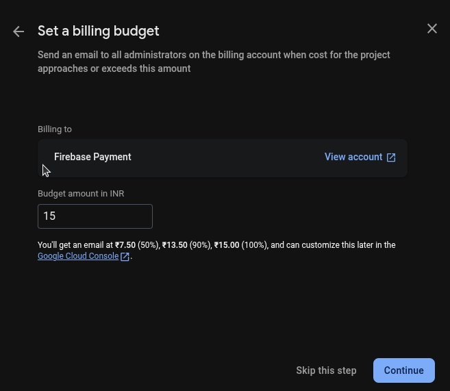
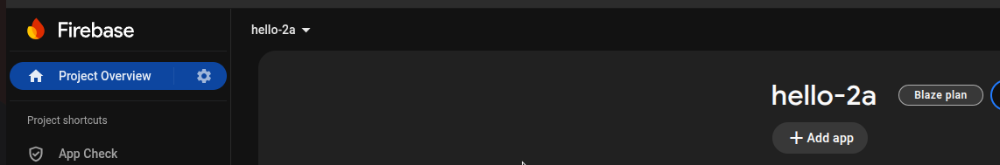
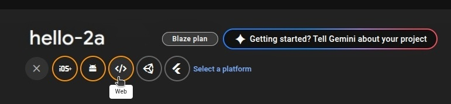
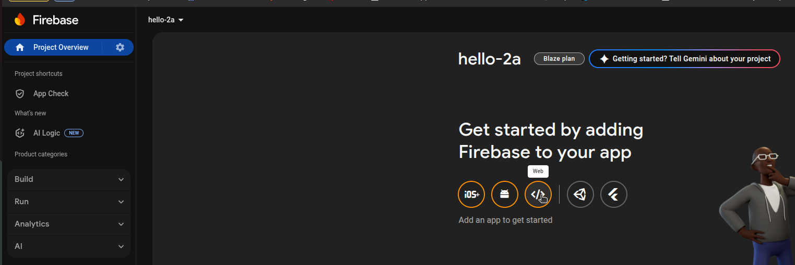
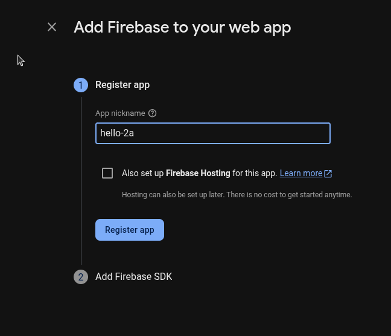
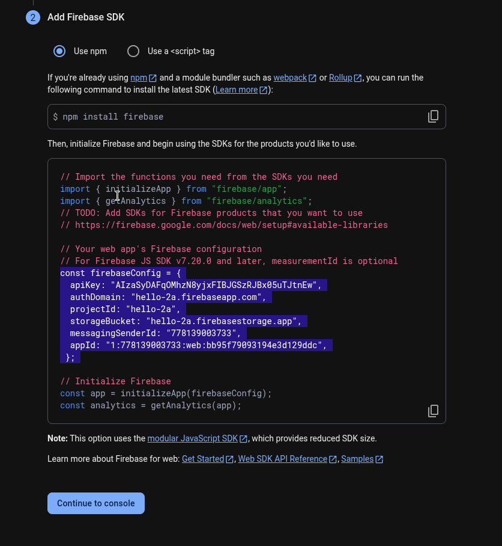
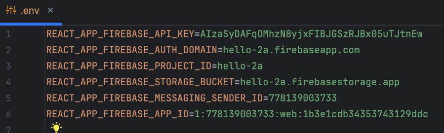
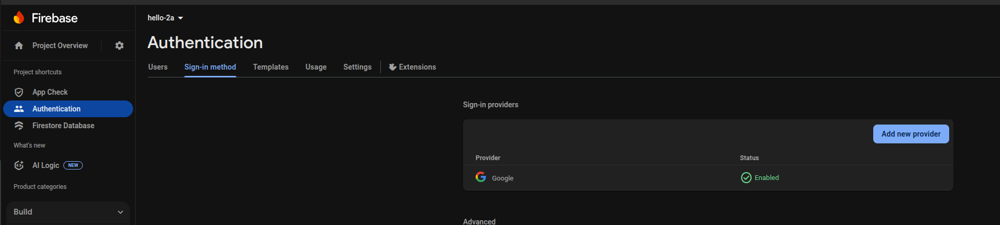

# Pennywise Setup

This guide will walk you through setting up the Pennywise project on a Linux/Microsoft/macOS environment.

## Prerequisites

- **Firebase Blaze Plan**: To use this project, you'll need to enable the Firebase "Blaze" (pay-as-you-go) plan. This
  requires adding a billing account to your Firebase project, for which a credit card is mandatory.


- **Govt ID Verification**: Please note that a Google Cloud billing account requires valid ID verification.
  While this is not an immediate blocker, and you can proceed with the initial setup,
  Google will eventually require verification to continue using the services (it will stop services after a few weeks).
  You will get an email from the Google Cloud team with detailed steps.


- **Free Tier Usage**: The Firebase Blaze plan offers a generous free tier, which should be sufficient for most personal use cases. https://firebase.google.com/pricing
    - 1 GB of storage in Firestore.
    - 50,000 reads, 20,000 writes, and 20,000 deletes per day
    - 1 GB of data transfer per month
    - 1 GB of storage in Firebase Storage
    - 1 GB of data transfer in Firebase Hosting
    - 1 GB of data transfer in Firebase Functions
    - 1 GB of data transfer in Firebase Authentication
    - Gmail import also uses Pub/Sub, Cloud Scheduler (one hourly job), Secret Manager, and the Gemini API. For one
      person's bank alerts these usually stay within free quotas or cost very little, but check
      https://cloud.google.com/pricing and the Gemini API pricing page for current limits.

> **Note:** I have been using this project for tracking my expenses for the last 2 years, and I have rarely crossed the
> free tier limits. Occasionally, I was billed ₹1-2 when I was testing Firestore with a high volume of requests.
> However, you can set up a billing budget to receive reminder emails, which helps ensure you stay within your desired
> spending limits.

## Minimum Technical Requirements

Before you begin, please ensure you have the following minimum versions installed on your system:

- **Node.js:** `v22.0.0` or higher
- **npm:** `v10.0.0` or higher
- **Firebase CLI:** installed in [Install Firebase CLI](#install-firebase-cli) below
- **Google Cloud CLI (`gcloud`)** and **Terraform** `v1.6.0` or higher: needed for the Gmail import infrastructure
  (see [Terraform and Gmail ingest](#terraform-and-gmail-ingest)) and for `npm run backup`

## Recommended Code Editor

We strongly recommend using a code editor like Visual Studio Code for this project. A dedicated code editor will make it much easier to:

- See and edit hidden files (like `.env` or `.firebaserc` files) that standard file explorers might hide
- Edit code with syntax highlighting
- Navigate the project structure efficiently

**Visual Studio Code:**
- Download VS Code from [https://code.visualstudio.com/download](https://code.visualstudio.com/download)

Other suitable code editors include:
- [Sublime Text](https://www.sublimetext.com/)
- [Atom](https://atom.io/)
- [WebStorm](https://www.jetbrains.com/webstorm/)

### Cloning the Project

You can get the project files either by cloning the repository using Git or by downloading the source code as a ZIP file.

- ** With VS Code:**
  1. Open Visual Studio Code.
  2. Follow this guide to clone a repository:
  3. https://code.visualstudio.com/docs/sourcecontrol/intro-to-git#_clone-a-repository-locally
  4. The repository URL is mentioned below:
   ```bash
      https://github.com/rushikc/pennywise.git
   ```
  

- **With Git:**
  ```bash
  git clone https://github.com/rushikc/pennywise.git
  ```
- **Direct Download:**
  Alternatively, you can download the project as a ZIP file from the repository's main page and extract it.
  Go to https://github.com/rushikc/pennywise, click on the "Code" button, and then click on "Download ZIP".

After cloning or extracting the project, you need to open a terminal and navigate to the project's root directory.

<details>
<summary>Windows</summary>

1.  **Open Terminal:** Right-click the Start button and select **Windows PowerShell** or **Command Prompt**.
2.  **Navigate to Directory:** Use the `cd` command. For example, if the project is in your `Downloads` folder, run:
    ```cmd
    cd C:\\Users\\YourUsername\\Downloads\\pennywise
    ```

</details>

<details>
<summary>macOS</summary>

1.  **Open Terminal:** Find the Terminal app in `Applications/Utilities` or search for it with Spotlight (`Cmd+Space`).
2.  **Navigate to Directory:** Use the `cd` command. For example:
    ```bash
    cd ~/Downloads/pennywise
    ```

</details>

<details>
<summary>Linux</summary>

1.  **Open Terminal:** Press `Ctrl+Alt+T` or search for "Terminal" in your applications menu.
2.  **Navigate to Directory:** Use the `cd` command. For example:
    ```bash
    cd ~/Downloads/pennywise
    ```

</details>


### Installing Node.js and npm

Here’s how you can install Node.js and npm on different operating systems. We recommend using a version manager like
`nvm` or `nvs` to make it easy to switch between Node.js versions.

<details>
<summary>Linux (using nvm)</summary>

1. **Install nvm (Node Version Manager):**
   Open your terminal and run the following command to install `nvm`:
   ```bash
   curl -o- https://raw.githubusercontent.com/nvm-sh/nvm/v0.39.3/install.sh | bash
   ```
   After the installation, restart your terminal or run `source ~/.bashrc` (or `~/.zshrc` if you are using zsh) to apply the changes.

2. **Install Node.js:**
   Now, you can install the latest LTS version of Node.js with:
   ```bash
   nvm install --lts
   nvm use --lts
   ```
   This will also install the corresponding version of `npm`.

3. **Verify the Installation:**
   Run the following commands to ensure everything is set up correctly:
   ```bash
   node -v
   npm -v
   ```

</details>

<details>
<summary>Windows (using the official installer)</summary>

1. **Download the Installer:**
   Go to the [official Node.js website](https://nodejs.org/en/download/) and download the Windows Installer (`.msi`) for
   the LTS version.

2. **Run the Installer:**
    - Double-click the downloaded `.msi` file.
    - Follow the prompts in the setup wizard. Make sure to select the option to install **"Tools for Native Modules"**
      if you plan to work with packages that require compilation.
    - The installer will automatically add `node` and `npm` to your system's PATH.

3. **Verify the Installation:**
   Open a new Command Prompt or PowerShell window and run:
   ```bash
   node -v
   npm -v
   ```

</details>

<details>
<summary>macOS (using Homebrew)</summary>

1. **Install Homebrew (if not already installed):**
   Open your terminal and run the following command to install Homebrew:
   ```bash
   /bin/bash -c "$(curl -fsSL https://raw.githubusercontent.com/Homebrew/install/HEAD/install.sh)"
   ```

2. **Install Node.js:**
   Once Homebrew is installed, you can install Node.js with a single command:
   ```bash
   brew install node
   ```
   This will install the latest version of Node.js and `npm`.

3. **Verify the Installation:**
   Run the following commands to ensure everything is set up correctly:
   ```bash
   node -v
   npm -v
   ```

</details>


## Getting Started

### Firebase Setup

1. **Navigate to the Firebase Console:**
   Open your web browser and go to [https://console.firebase.google.com/](https://console.firebase.google.com/).

2. **Create a New Firebase Project:**
    - Click on **"Add project"** to start the setup process.
    - Enter a unique name for your project; this will be your project ID (e.g., `hello-2a`, `finance-app-3455`).
    - It's best to choose a unique name, as it will be part of your app's URL: `https://<your-project-id>.web.app`.
    - Firebase will show the final, unique Project ID below the input box. If your first choice is unavailable, it will append random characters to it.
    - Uncheck **"Enable Google Analytics for this project"** and click **"Create project"**.

3. **Access Your Project Dashboard:**
   Once the project is created, you will be redirected to the project's dashboard.

   

4. **Upgrade to the Blaze Plan:**
    - By default, your project will be on the "Spark" plan. To enable all features required for Pennywise, you must
      upgrade to the "Blaze" (pay-as-you-go) plan.
    - In the bottom-left corner of the navigation menu, click on the **"Upgrade"** button.
    - Select the **Blaze plan** and follow the prompts to create a Cloud Billing account. This will require a credit
      card for verification, which may involve a small transaction (e.g., 2 rupees).

5. **Set a Billing Budget:**
    - After setting up your billing account, you will be prompted to create a budget. It is highly recommended to set a
      budget to prevent unexpected charges.
    - For example, you can set a monthly budget of ₹15.
    - Once your budget is set, link the Cloud Billing account to your project.

   

6. **Enable Web App Configuration:**

  - In the Firebase console, you will get two types of landing pages.
  - If you get the one below, click on the **"+ Add app"** button, then the web app icon to add a web app to your project.

  

  - Click on the web icon to add a web app to your project.

  

  - If you get the one below, click on the web app icon pointed to in the screenshot.

  

  - Enter a nickname for your app (e.g., `hello-2a`) and do not check the box to set up Firebase Hosting.
  - Firebase Hosting is only required if you want to use an externally bought domain, which is not required for this project.
  - Click **"Register app"**.

  

  - After registering your app, you will see a configuration snippet.
  - Copy this snippet, highlighted in blue in the screenshot below.

  

  - Copy [`.env.example`](.env.example) to `.env` in the root folder and paste each key-value configuration in the format below.
  - The app is built with Vite but keeps the `REACT_APP_` prefix for its variables. Use the following format:
  ```env
  REACT_APP_FIREBASE_API_KEY=your-api-key
  REACT_APP_FIREBASE_AUTH_DOMAIN=your-auth-domain
  REACT_APP_FIREBASE_PROJECT_ID=your-project-id
  REACT_APP_FIREBASE_STORAGE_BUCKET=your-storage-bucket
  REACT_APP_FIREBASE_MESSAGING_SENDER_ID=your-messaging-sender-id
  REACT_APP_FIREBASE_APP_ID=your-app-id
  # Filled in later, in "Terraform and Gmail ingest" (public OAuth Web client id):
  REACT_APP_GOOGLE_OAUTH_CLIENT_ID=your-oauth-web-client-id.apps.googleusercontent.com
  # Optional, only if you wire Firebase Analytics:
  # REACT_APP_FIREBASE_MEASUREMENT_ID=G-xxxxxxxxxx
  ```
  - The final `.env` content should look like the image below (plus the `REACT_APP_GOOGLE_OAUTH_CLIENT_ID` line):

  <!-- TODO: update screenshot -->
  

7. **Update Project ID in Firebase config:**

  - Copy [`.firebaserc.example`](.firebaserc.example) to `.firebaserc` in the root directory (the real file is gitignored).
  - Set `default` and `personal` to your Firebase project ID. `demo` is only for the public Hosting-only demo project.
  ```txt
      {
          "projects": {
            "default": "your-personal-project-id",
            "personal": "your-personal-project-id",
            "demo": "your-demo-project-id"
          }
      }
  ```


8. **Enable Google Authentication:**
   - In the Firebase project console, navigate to **Authentication** under `Build` in the left sidebar.
   - Click on the **"Get Started"** button if prompted.
   - Under the **Sign-in method** tab, enable **Google** authentication.
   - Click on **Enable** and provide your email as the support email.
   - Click on **Save**. It should look like the screenshot below after setup.




9. **Enable Firestore API:**
    - Go to the URL [Developer Console URL](https://console.developers.google.com/apis/api/firestore.googleapis.com/overview?project=your-project-id)
    - Make sure you are logged in with the same Google account you used to create your Firebase project.
    - Replace `your-project-id` in the URL with your actual Firebase project ID.
    - Click on the top-left side `Select Project` and choose your actual Firebase project ID.
    - Click on the **"Enable"** button to enable the Firestore API for your project.


### Install Firebase CLI

To interact with Firebase services from your terminal, you need to install the Firebase CLI.

- **Install Firebase CLI:**
  Open your terminal and run the following command:
    ```bash
    npm install -g firebase-tools
    ```
  `firebase-tools` is also a dev dependency of the project, so after `npm install` you can run it with `npx firebase` instead.

### Project Setup

- **Install npm dependency**
  Run the following command to install all necessary dependencies:
  ```bash
  npm install
  npm ci --prefix functions
  ```
  The second command installs the Cloud Functions dependencies; `firebase deploy` builds and lints the functions but does not install them.

- **Set up Environment Files:**

  1. **Create a `.env` file in the functions folder:**
     - Create `functions/.env` with the public OAuth web client id (same value as the React env var):
     ```
     GOOGLE_OAUTH_CLIENT_ID=your-oauth-web-client-id.apps.googleusercontent.com
     ```

  2. **OAuth client secret and Gemini API key** are not committed. After Terraform apply, add versions to the secret shells named in `shared/gcpNames.json`. See [infra/terraform/README.md](infra/terraform/README.md).

- **Build web app:**
  Run the following command to build the web app from the root folder (Vite writes the output to `build/`, which Firebase Hosting serves):
  ```bash
  npm run build
  ```

-  **Firebase Login:**
   Run the following command to log in to Firebase from the root folder:
      ```bash
      firebase login
      ```
   - This will open a browser window for you to log in with your Google account.


-  **Initialize Firestore and Hosting:**
    - You will see a few warnings saying the API is not enabled, but you can ignore them.
    - Firebase will enable them on your behalf during the first deployment.
    - Deploy Firestore and Hosting first. The Cloud Functions need the service account and secrets created in
      [Terraform and Gmail ingest](#terraform-and-gmail-ingest), so deploy them after that section.
   ```bash
   firebase deploy --only firestore,hosting
   ```

- **Artifact Storage:**
  - If you get the question below, just enter 1 for backup days and press Enter.
  ```txt
  ✔ How many days do you want to keep container images before they're deleted?
  ```

- **Enable Firestore Rules:**
  - Paste [`firestore.rules`](firestore.rules) into the Firebase console **Rules** tab, or run `firebase deploy --only firestore:rules`.
  - Create one document per family member at `allowedUsers/{lowercase-email}` (empty document is enough). Document IDs must be the email in lowercase.

### Terraform and Gmail ingest

1. Follow the Bootstrap checklist in [infra/terraform/README.md](infra/terraform/README.md): create the state bucket, `terraform init -backend-config=backend.hcl`, `plan`, `apply`.
2. Create an OAuth **Web** client. Authorized JavaScript origins: `http://127.0.0.1:3000` and `https://<project-id>.web.app`.
3. Consent screen **In production**. Add scope `https://www.googleapis.com/auth/gmail.readonly` only.
4. Put `REACT_APP_GOOGLE_OAUTH_CLIENT_ID` in the app `.env` and `GOOGLE_OAUTH_CLIENT_ID` in `functions/.env`.
5. Add the OAuth client secret and Gemini API key as secret versions (commands in [infra/terraform/README.md](infra/terraform/README.md)), rebuild the web app with `npm run build`, then run `firebase deploy`. It deploys the functions (`connectGmail`, `disconnectGmail`, `onGmailPush`, `hourlyGmailSweep`) and creates the Pub/Sub trigger subscription and the hourly scheduler job.
6. Deploy or paste `firestore.rules`. Create `allowedUsers/{lowercase-email}` for each family member.
7. Sign in, open Settings, and **Connect Gmail**. The first connection imports matching bank mail from the last 30 days in the background.

### Existing install / upgrade

Rules and the frontend now read and write `users/{uid}/...`. Data left in the old root collections (`expense`, `vendorTag`, `budget`, `config`) is **hidden until you migrate**. Do this before relying on live mode or Gmail ingest:

1. **Back up.** From the repo root: `npm run backup` (see `scripts/backup`). Keep the timestamped export directory.
2. **Allowlist.** Create `allowedUsers/{lowercase email}` documents (empty is enough). IDs must be lowercase; mixed-case IDs will not match.
3. **Migrate.** Dry-run first, then apply (do not skip `config`, including `emailParseBanks` — ingest skips every message if banks are missing):
   ```bash
   npm run migrate -- --from <backup-dir> --uid <firebaseUid>
   npm run migrate -- --from <backup-dir> --uid <firebaseUid> --apply
   ```
4. **Deploy rules and functions** (`firebase deploy --only firestore:rules,functions` or full `firebase deploy`).
5. **Connect Gmail** in Settings after you sign in.

See also [infra/terraform/README.md](infra/terraform/README.md) if GCP resources from the Gmail push re-architecture are not applied yet.

---

## Post-Setup Instructions

Congratulations! You have successfully completed the setup for Pennywise.

### Accessing the App

You can now start using the application by navigating to `https://<your-project-id>.web.app` in your web browser. Replace `<your-project-id>` with the ID of your Firebase project.

### Installing as a PWA

For a more native experience, you can install Pennywise as a Progressive Web App (PWA) directly from Google Chrome on both Android and iOS devices.

### Automatic expense tracking

Gmail `users.watch` publishes new INBOX mail to Pub/Sub. The Cloud Function parses matching bank mail (regex first, Gemini fallback) into `users/{uid}/expense/{gmailMessageId}`. An hourly job renews the watch and backfills gaps. After each import, duplicate alerts are merged automatically or queued in **Settings → Duplicate Review**.

New imports show up the next time the app loads data. Use **Settings → Reload Data** to pull them in sooner. **Settings** also shows the Gmail connection status and any last error.

You are responsible for **Gemini API usage/costs** on your Google Cloud / AI Studio billing. Use a billed key.

### Important next steps

1.  **Configure tags:** In **Settings**, add tags you want for categorization (not pre-populated).

2.  **Configure banks (required for automation):** Open **Settings → Banks**. For each bank or card program that sends transaction emails, add a **display name** and one or more **match strings** (unique phrases that appear in those alerts, e.g. bank name + “debited” or “UPI”). Add several strings if templates differ slightly. Cloud Functions ingest only parses matching mail (regex first, Gemini when regex fails)—too few strings and you may miss mail; too generic and you may include noise.

3.  **Vendor tags (optional):** Map normalized vendor strings to a **primary** tag in **Settings → Manage Vendor Tags**; ingest attaches `tags: [primary]` (and the `tag` mirror) when the parsed vendor matches a map exactly. Use **Settings → Auto-tag Expenses** to apply your maps to older untagged expenses. Extra tags and notes come from a local enrichment process, not from Gmail. See [docs/DATA_MODEL.md](docs/DATA_MODEL.md).

4.  **Duplicate review (optional):** Check **Settings → Duplicate Review** now and then. It lists pairs that might be the same transaction; choose **Confirm duplicate** or **Not a duplicate**.

Happy expense tracking!
