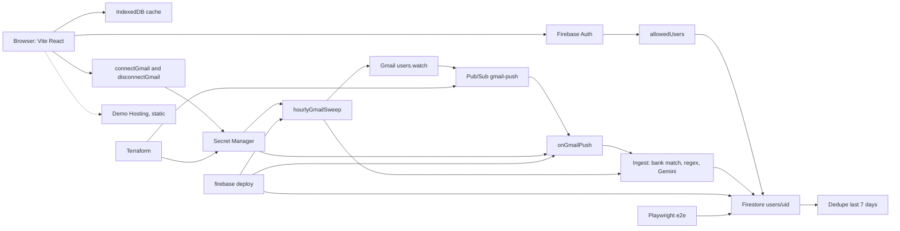

# Architecture

Pennywise is a Vite React app. Live mode stores data in the owner's Firebase project. A separate demo Hosting site is a static build with no Firebase. Gmail import runs in Cloud Functions: a push from Gmail, plus an hourly sweep.

Firestore lives in `asia-south2` (`firebase.json`). Cloud Functions run in `asia-south1` (`shared/gcpNames.json`, `functionsRegion`). Topic and secret ids below come from that same file and from `functions/index.js`.

## Diagram

## Web app

The browser loads expenses, vendor tags, budgets, and config from Firestore under `users/{uid}/expense`, `vendorTag`, `budget`, `config`, `meta`, and `private`. After the first fetch, later loads ask only for documents whose `modifiedDate` changed. The same records sit in an IndexedDB database, one per user.

Sign-in is Firebase Auth with Google. A verified email can read live data only when `allowedUsers/{lowercase-email}` exists. Everyone else stays on demo data inside the same app.

`vite build --mode demo` sets `__DEMO_BUILD__`. That bundle blanks Firebase env keys and does not initialize Firebase, Auth, Firestore, Functions, or Google Identity Services. The public demo site is Hosting only.

## Gmail

`connectGmail` and `disconnectGmail` are callable functions. Connect stores the refresh token in Secret Manager and registers `users.watch` on the Terraform topic `gmail-push`.

`onGmailPush` reads Gmail history, keeps mail that matches the user's banks, parses with regex first and Gemini when regex cannot, and writes `users/{uid}/expense/{gmailMessageId}`. After an import, duplicate detection scans expenses from the last 7 days.

`hourlyGmailSweep` runs every hour. It renews a watch when expiration is under 2 days, catches up on mail the push missed, and continues a resumable backfill of the last 30 days. It finds connected accounts in the top-level `gmailConnections` collection.

The OAuth client secret is `pennywise-oauth-client-secret`. The Gemini key is `pennywise-gemini-api-key`. Both are Secret Manager shells. `functions/index.js` also exports `pennywiseApi`, an HTTPS function that reads `pennywise-api-token` and `pennywise-api-token-next`. That function is unreleased. This page does not describe its routes. The choice between that function and a local Python writer is still open.

## Who creates what

Terraform creates the APIs, the `gmail-push` topic and its publisher IAM, the functions service account `pennywise-functions`, and the Secret Manager shells. It does not write secret versions.

`firebase deploy` ships function source, Hosting, and Firestore rules and indexes. Deploying functions also creates the Pub/Sub subscription that invokes `onGmailPush` and the Cloud Scheduler job for `hourlyGmailSweep`.

OAuth consent, the OAuth web client, and `allowedUsers` documents are created by hand.

## End-to-end tests

Playwright starts the Firestore emulator on `127.0.0.1:8080`, the Auth emulator on `127.0.0.1:9099`, and the Functions emulator on `127.0.0.1:5001`, then serves `vite preview --mode e2e` on port 3100. The e2e build talks only to those emulators. See [tests/README.md](../tests/README.md).

## More detail

- [Data model](DATA_MODEL.md)
- [Demo deploy](DEMO_DEPLOY.md)
- [Security](../SECURITY.md)
- [Terraform](../infra/terraform/README.md)
